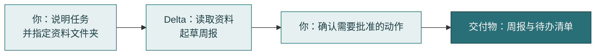
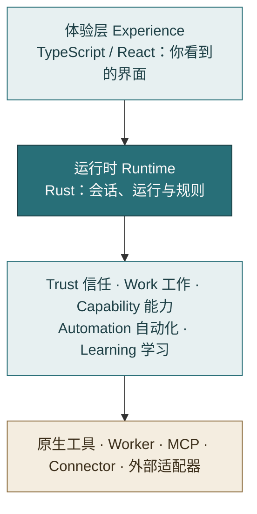
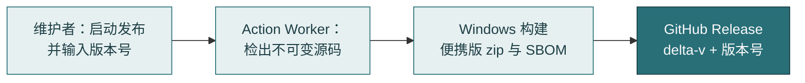

<div align="center">


# Delta

本地优先的个人 AI 工作助手，专注于日常办公、研究分析与内容创作。

[](LICENSE)
[](.python-version)
[](.nvmrc)
[](rust-toolchain.toml)
[](apps/desktop)
[](CHANGELOG.md)

[快速开始](#快速开始) · [贡献指南](CONTRIBUTING.md) · [安全策略](SECURITY.md)

</div>

> 新手请从 **这是什么** 读到 **快速开始**。维护者可直接跳到 [维护者参考](#维护者参考)。

**目录**：[这是什么](#这是什么) · [一个例子](#一个例子) · [快速开始](#快速开始) · [进阶](#进阶delta-如何工作) · [仓库结构](#仓库结构) · [维护者参考](#维护者参考) · [参与贡献](#参与贡献) · [安全](#安全) · [许可与商标](#许可与商标)

## 这是什么

Delta 是一个运行在你电脑上的 AI 助手（Agent，能自主规划并调用工具完成任务的程序）。你交给它一项工作，它会读取资料，产出文档、表格、报告等**交付物**（Artifact），并在关键步骤请你确认。

- **本地优先**：工作记录和文件默认保存在你的电脑上。只有你明确启用的能力才会访问外部服务。
- **可控**：对外发送内容等高风险动作，必须先经过你的审批。
- **可追溯**：每个结果都能说明来源。

| 领域 | 典型任务 |
| --- | --- |
| 日常办公 | 整理文档、处理表格与 PDF、准备演示文稿 |
| 研究分析 | 设计试验、统计分析、撰写研究报告 |
| 内容创作 | 写作与编辑、图文素材、多平台发布准备 |

## 一个例子

假设你对 Delta 说："把这周的会议记录整理成周报，并列出待办事项"，并指定记录所在的文件夹。



如果某个动作需要确认（比如把周报发到外部），Delta 会先问你。

## 快速开始

### 1. 安装前置工具

| 工具 | 版本 | 安装方式 |
| --- | --- | --- |
| Python | 3.12 | [python.org](https://www.python.org/downloads/) |
| Node.js | 22 | [nodejs.org](https://nodejs.org/) |
| Rust | stable | [rustup.rs](https://rustup.rs/) |
| uv | **0.12.3**（必须精确一致） | `pip install uv==0.12.3` |

另外还需要 [Tauri 的系统依赖](https://tauri.app/start/prerequisites/)，按其官方说明安装即可。

> **开始前须知**
> - `uv` 必须精确为 0.12.3。
> - 首次启动必须选择出站级别；选择之前不会向任何模型发送请求。
> - 首次编译 Rust 需要几分钟。

### 2. 获取代码并启动

在终端中依次运行（每行一步）：

```bash
git clone https://github.com/fongap-labs/delta.git
cd delta
uv sync --locked --extra dev   # 安装 Python 依赖，严格按锁文件版本
cd apps/desktop
npm install                    # 安装前端依赖
npm run tauri dev              # 启动桌面应用（首次编译 Rust 需要几分钟）
```

应用窗口打开即表示成功。首次启动时，Delta 会请你选择**出站级别**，即 Delta 能把内容发送到哪里。选择之前，它不会向任何模型发送请求。

| 级别 | 含义 |
| --- | --- |
| 开放（Open） | 可以使用任何已配置的端点 |
| 已批准端点（Approved endpoints） | 只使用你批准过的端点，例如公司网关 |
| 仅私有（Private only） | 只使用本机或内网的端点 |
| 每次询问（Ask each time） | 每次运行前由你确认端点 |

> **端点（endpoint）**：模型服务的网络地址。

端点可以是云端服务，使用时的费用由所选服务商计费；选择『仅私有』时只使用本机或内网端点。

### 常见问题

- **`uv sync` 报版本错误**：运行 `uv --version`，必须显示 `0.12.3`。
- **第一次编译很慢**：Rust 首次编译需要几分钟，属正常现象。
- **平台**：目前已支持 Windows x64，发布产物为便携版 zip（构建目标 `x86_64-pc-windows-msvc`）。其他系统的开发支持未在本文确认，请以维护者说明为准。

## 进阶：Delta 如何工作



- **运行时（Runtime）**：Delta 的核心。它对工作状态、审批和验证拥有**权威（Authority）**，即某件事只由一个模块负责。
- **能力（Capability）**：Delta 能调用的功能，如读取 PDF、网页搜索、统计计算。它的来源可以是原生工具、受控 Worker（独立的执行进程）、MCP（外部工具协议）或 Connector（外部服务连接器）。
- **Skill（技能）**：可复用的工作方法，定义步骤和验证方式，但不能改写安全规则。
- **扩展**：可选扩展只依赖公开合同；Delta 核心不依赖任何具体扩展，反向依赖是禁止的。

## 仓库结构

| 目录 | 内容 |
| --- | --- |
| `apps/` | 桌面应用（`apps/desktop`） |
| `crates/` | Rust 代码，包括运行时 |
| `integrations/`、`packages/` | 能力、连接器与共享包 |
| `contracts/`、`schemas/`、`delta_extension_api/` | 合同、JSON Schema 与扩展接口 |
| `packaging/`、`resources/`、`scripts/` | 打包、品牌资源与维护脚本 |
| `docs/` | 产品、架构与治理文档 |

## 维护者参考

Delta 的共用工程规则由 **Action Worker**（Fongap Labs 的统一 CI 与发布平台）维护。可以把它想成一个**中央质检车间**：所有改动都送到那里检查，通过后才能合并。

- **Runner（运行器）**：车间里临时分配给任务的电脑，用完即还。
- **Security Gate（安全门禁）**：第一道安全检查。
- **validate-merge**：唯一的合并许可。
- **AI Review**：AI 给出的参考意见，不替代以上任何检查。

### 发布



- 版本号只来自发布时手动输入的值，仓库文件中的版本字段不参与决定。
- 发布清单位于 `.github/release.manifest.json`。SBOM 即软件物料清单，列出产物包含的组件。

### 文档

[产品蓝图](docs/DELTA_BLUEPRINT.md) · [目标架构](docs/architecture/target-architecture.md) · [扩展边界](docs/governance/REPOSITORY_BOUNDARY.md) · [ADR 索引](docs/architecture/adr/README.md) · [治理索引](docs/governance/README.md) · [CHANGELOG](CHANGELOG.md)

## 参与贡献

完整规则见 [CONTRIBUTING.md](CONTRIBUTING.md)，要点如下：

- 面向人的文档用中文；代码改动、PR 标题和 CHANGELOG 用英文。
- 分支从 `main` 创建，使用 `feat/`、`fix/`、`docs/` 等前缀。
- 提交遵循 Conventional Commits，并用 `git commit -s` 签署 DCO（确认你有权提交这段代码）。
- PR 默认以 Squash merge 合并（把一个分支的所有提交压成一个再合并）。

### 本地检查

以下检查在 CI 中统一执行，本地运行用于提前发现问题。

| 命令 | 作用 |
| --- | --- |
| `python scripts/check_brand_icons.py --verify` | 检查图标是否与品牌源文件一致 |
| `python scripts/check_naming.py` | 检查文件命名 |
| `python scripts/check_repository_boundary.py` | 检查扩展边界 |
| `cd apps/desktop && npm test` | 桌面端单元测试 |
| `cd apps/desktop && npm run e2e` | 桌面端端到端测试（需要浏览器） |
| 在对应 crate 目录内运行 `cargo test` | Rust 测试 |

本仓库没有根级 `tests/` 目录。Python 合同测试位于 `fongap-labs/action-worker`，Rust 与桌面端测试与代码放在一起。

## 安全

请不要在公开 Issue 中披露漏洞。使用 GitHub 私密报告：**Security → Advisories → Report a vulnerability**。详见 [SECURITY.md](SECURITY.md)。

- 首次启动选择出站级别之前，不向任何模型发送请求。
- 对外发送内容等高风险动作需先经用户审批。

## 许可与商标

Delta 的 Foundation 源码采用 [Apache License 2.0](LICENSE)。第三方组件保留各自的许可证，见 [THIRD_PARTY_NOTICES.md](THIRD_PARTY_NOTICES.md)。未修改的上游可以称为 Delta；修改后再发行须使用自有名称，详见 [商标与品牌治理](docs/governance/baseline/TRADEMARK_BRAND_GOVERNANCE.md)。
