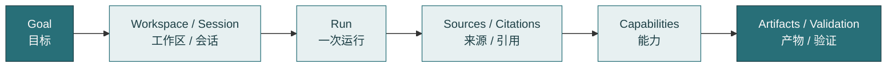
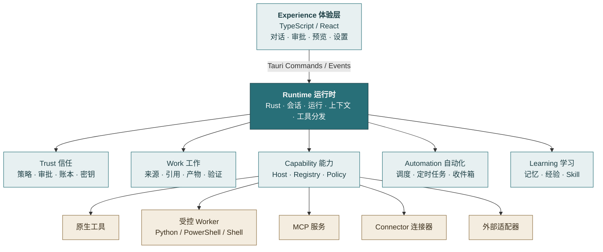
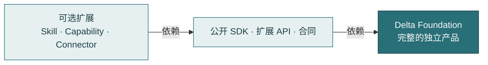
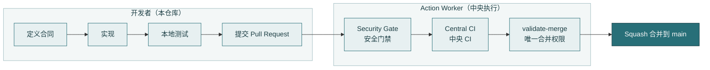
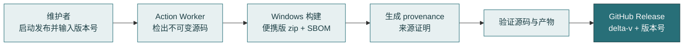

<div align="center">


# Delta

**本地优先的个人工作 AI Agent**

日常办公 · 研究分析 · 内容创作

[](LICENSE)
[](.python-version)
[](.nvmrc)
[](rust-toolchain.toml)
[](apps/desktop)
[](CHANGELOG.md)

[快速开始](#快速开始) · [目标架构](docs/architecture/target-architecture.md) · [产品蓝图](docs/DELTA_BLUEPRINT.md) · [贡献指南](CONTRIBUTING.md) · [安全策略](SECURITY.md)

</div>

## 阅读路径

| 你的目标 | 从这里开始 |
| --- | --- |
| 第一次了解 Delta | [这是什么](#这是什么)、[为什么需要它](#为什么需要它) |
| 想先把它跑起来 | [快速开始](#快速开始) |
| 想理解架构与扩展方式 | [工作方式](#工作方式)、[扩展模型](#扩展模型) |
| 想参与开发或发布 | [仓库结构](#仓库结构)、[维护者参考](#维护者参考)、[参与贡献](#参与贡献) |

## 这是什么

Delta 是一个**本地优先**的个人工作 AI Agent（能自主规划并调用工具完成任务的 AI 程序）。

你把一项真实工作交给它：它读取资料、调用工具，产出文档、表格、报告等**交付物**（Artifact），并在关键步骤请你确认。核心工作状态保留在你的电脑上，除非某项能力明确使用外部服务。

Delta 聚焦三个领域：

| 领域 | 典型任务 | 目标闭环 |
| --- | --- | --- |
| 日常办公 | 整理文档、处理表格与 PDF、准备演示文稿、汇总邮件与会议材料 | 读取 → 理解 → 修改 / 创建 → 验证 → 预览 → 交付 |
| 研究分析 | 设计试验、统计分析、建模与可视化、撰写正式研究报告 | 研究问题 → 试验设计 → 分析 → 解释 → 报告 |
| 内容创作 | 选题与研究、写作与编辑、图文与视频素材、多平台适配 | 选题 → 写作 → 编辑 → 多平台适配 → 发布准备 → 复盘 |

Delta 不以堆叠模型或 Agent 为目标，而是以**完成真实工作**为目标，同时让执行过程保持**可控、可恢复、可验证、可追溯**。

## 为什么需要它

通用 Agent 能完成很多单步操作。但工作持续时间变长后，如果状态、权限、证据、副作用和交付物只存在于对话上下文里，任务就会变得脆弱。

Delta 把这些边界显式化：

| 维度 | 常见做法（隐含在上下文中） | Delta（显式记录） |
| --- | --- | --- |
| 工作状态 | 留在对话里，中断即丢失 | 记录在 Workspace / Session / Run 中，可暂停、恢复 |
| 权限与审批 | 执行中临时决定 | 由 Policy（策略）与 Approval（审批）统一裁决，高后果动作必须确认 |
| 来源与证据 | 难以追溯 | Source（来源）与 Citation（引用）绑定到工作记录 |
| 交付物 | 散落在聊天记录中 | Artifact 附带 Validation（验证），可预览、可版本化 |
| 失败之后 | 只能重来 | Ledger（账本）记录事实，支持 Resume（继续执行）与 Recovery（故障恢复） |



模型可以决定如何推进；Delta 则对工作状态、审批、恢复、来源证明（Provenance，即"这个结果从哪里来"的记录）和验证保有 **Authority**（权威，即某类事实或决定的唯一负责方）。

核心原则：

| 原则 | 含义 | 在 Delta 中的体现 |
| --- | --- | --- |
| 本地优先 | 核心工作状态留在本地 | 外部服务只在具体能力明确使用时才参与 |
| 人掌握后果 | 高后果动作必须经过策略与审批 | 外发内容等动作由出站级别与审批共同裁决 |
| 任务可恢复 | 工作可暂停、取消、恢复、复查 | Run 与 Ledger 记录执行过程 |
| 成果可验证 | 来源、引用、版本与验证属于工作记录 | Artifact 与 Validation 绑定 |
| 扩展有边界 | 新领域通过 Skill 与 Capability 接入 | 不新建平行的 Runtime 或 Authority |
| 模型边界收敛 | 只维护 OpenAI-compatible 与 Anthropic-compatible 接口 | 模型聚合、密钥轮换、回退与额度位于 Delta Core 之外 |

## 工作方式

Delta 的前端、运行时和能力各自承担明确的职责：



一句话边界：**TypeScript 负责产品交互，Rust 负责 Runtime、状态、规则与事实；Python、PowerShell、Shell 只作为受控的工作执行语言。**

术语速查：

| 术语 | 含义 |
| --- | --- |
| Runtime（运行时） | Delta 的核心引擎（Rust），负责会话、运行、状态与规则 |
| Authority（权威） | 某项职责的唯一负责方；同一职责只能有一个 Authority |
| Capability（能力） | Delta 可调用的一项功能，例如读取 PDF、网页搜索、统计计算 |
| Worker（受控 Worker） | 在 Runtime 监督下运行的独立执行进程，不拥有核心状态 |
| MCP（Model Context Protocol） | 让外部工具服务接入 Agent 的开放协议 |
| Connector（连接器） | 连接外部服务的标准化适配层，受合同约束 |
| Skill（技能） | 可复用的工作方法：指令、流程、所需能力、权限与验证方式 |
| Artifact（产物） | 工作的交付物，如文档、表格、图表 |
| Validation（验证） | 对产物的检查，确认其符合要求 |
| Ledger（账本） | 记录关键事件的审计日志，用于追溯与复盘 |
| Policy / Approval（策略 / 审批） | 策略判定哪些动作需要确认；审批由用户给出 |
| Foundation（Delta Foundation） | 本仓库所代表的完整产品内核，可独立构建、运行与测试 |

## 扩展模型

**Skill（技能）** 是可复用工作方法的主要扩展单位。Skill 只定义执行流程，不得覆盖机器合同、策略或规则。

**Capability（能力）** 可以由原生工具、受控 Worker、MCP 服务、Connector 或外部适配器提供。

可选扩展只依赖 Delta 的**公开扩展合同**。Delta Foundation 不依赖任何具体扩展实现；扩展也不拥有 Runtime、Trust 或 Work 的 Authority。



依赖只允许单向流动：**扩展 → 公开合同 → Foundation**。禁止反向依赖，具体规则见 [扩展边界](docs/governance/REPOSITORY_BOUNDARY.md)。

## 快速开始

### 环境要求

| 工具 | 版本 | 版本来源 | 用途 |
| --- | --- | --- | --- |
| Python | 3.12（最低 3.11） | `.python-version` | 受控 Worker 与 Python 依赖 |
| uv | 0.12.3 | `pyproject.toml` 的 `required-version` | Python 依赖管理，按锁文件安装 |
| Node.js | 22 | `.nvmrc` | 桌面端前端构建 |
| Rust | stable | `rust-toolchain.toml` | Runtime 与 Tauri 后端 |
| Tauri 系统依赖 | 按 Tauri 官方要求 | [Tauri 文档](https://tauri.app/start/prerequisites/) | 桌面窗口 |

### 启动桌面应用（开发版）

```bash
# 1. 安装 Python 依赖（--locked 表示严格按 uv.lock 中锁定的版本安装）
uv sync --locked --extra dev

# 2. 进入桌面端目录，安装前端依赖
cd apps/desktop
npm install

# 3. 启动开发版（同时启动前端与 Rust 后端；第一次编译 Rust 耗时较长，属正常现象）
npm run tauri dev
```

### 首次启动：选择出站级别

首次启动时，Delta 会请你选择默认的**出站级别**（Egress Level，即 Delta 可以把内容发送到哪些地方）。在你选择之前，Delta 不会向任何模型发送请求。

| 档位 | 允许的端点 | 适合的场景 |
| --- | --- | --- |
| 开放（Open） | 任何已配置的端点 | 公开资料、个人使用 |
| 已批准端点（Approved endpoints） | 仅用户标记为已批准的端点，例如公司 AI 网关 | 有经批准的云服务或网关的组织 |
| 仅私有（Private only） | 仅本机或私有网络上的端点，以及用户标记为私有的端点 | 使用本地或自托管模型的机密数据 |
| 每次询问（Ask each time） | 任何端点，但每次运行前由你确认 | 混合型工作，逐案决定 |

## 仓库结构

| 目录 | 职责 |
| --- | --- |
| `apps/` | 用户可运行的应用，当前为桌面端 `apps/desktop/`（TypeScript / React + Tauri） |
| `crates/` | Rust 实现的 Runtime 与配套 crate，如 `delta-core`、`delta-computer`、`delta-sdk` |
| `integrations/` | 能力、连接器、工具与网页等外部集成 |
| `packages/` | 共享基础包，以及 Python Worker SDK（`delta_worker_sdk`） |
| `delta_extension_api/` | 面向可选扩展的稳定 Python 扩展 API |
| `contracts/` | 版本化的跨进程合同说明；JSON Schema 位于 `schemas/` |
| `schemas/` | 合同的 JSON Schema 定义 |
| `core/` | 少量 Python 辅助代码（Runtime 主体已在 Rust 中，其余迁移仍在进行） |
| `packaging/` | Windows 便携版的打包与启动器 |
| `resources/` | 品牌资源与截图 |
| `scripts/` | 仓库维护与校验脚本 |
| `docs/` | 产品、架构、治理与运维文档 |
| `.github/` | Issue / PR 模板、发布清单与薄的 CI 入口 |

> 本仓库没有根级 `tests/` 目录。Python 合同与集成测试位于 `fongap-labs/action-worker` 的 `tests/packs/delta/`；Rust 与桌面端测试与代码放在一起。

---

## 维护者参考

> 以下内容面向维护者。初次了解 Delta 的读者可以跳过。

### 治理边界

Delta 继承 Fongap Labs 的共用工程治理（由 [Action Worker](https://github.com/fongap-labs/action-worker) 维护）。业务仓库与 Action Worker 的分工如下：

| 归本仓库（业务仓库） | 归 Action Worker（中央执行平面） |
| --- | --- |
| 产品源码与项目测试 | 命名、变更分类、PR 门禁等共用规则 |
| 项目架构与边界规则 | CI、构建、审查、发布与部署的执行 |
| 构建与打包脚本 | 合并门禁 `validate-merge`（唯一的合并权限） |
| 执行清单，如 `.github/release.manifest.json` | 产物来源证明（provenance）与运行器解析 |

AI Review（AI 审查）只提供参考意见，不构成合并门禁。

### 开发流程



### 本地检查

以下检查在 CI 中由 Action Worker 统一执行；本地运行可以提前发现问题。

| 检查 | 命令 | 作用 |
| --- | --- | --- |
| 品牌图标 | `python scripts/check_brand_icons.py --verify` | 确认生成的图标由 `resources/brand/` 源文件派生且未过期 |
| 命名 | `python scripts/check_naming.py` | 校验文件与模块命名 |
| 扩展边界 | `python scripts/check_repository_boundary.py` | 检查 Foundation 与可选扩展之间的仓库边界 |
| 桌面端单元测试 | `cd apps/desktop && npm test` | 运行 Vitest 测试 |
| 桌面端端到端测试 | `cd apps/desktop && npm run e2e` | 运行 Playwright 测试（需要浏览器） |
| Rust 测试 | 在对应 crate 目录内运行 `cargo test` | 测试与代码位于同一目录 |

### 发布

发布意图由 `.github/release.manifest.json` 声明。Action Worker 检出不可变的源码，在集中解析的运行器上执行 Windows 构建，生成来源证明，验证源码与产物，并将 `delta-v` 加版本号的 Release 发布到本仓库的 GitHub Releases。



- 发布版本只来自发布启动时人工输入的版本号；仓库文件中的版本字段不参与决定。
- 目标产物为 `delta-windows-x64-portable.zip`（Windows x64 便携版），并附带 SBOM（软件物料清单）。
- 目标仓库凭据与发布权限不存储在本仓库中。

### 文档索引

| 文档 | 作用 | 读者 |
| --- | --- | --- |
| [产品蓝图](docs/DELTA_BLUEPRINT.md) | 产品定位、三个领域与长期边界 | 所有人 |
| [目标架构](docs/architecture/target-architecture.md) | 七个逻辑模块与语言职责 | 开发者 |
| [Runtime 合同](docs/architecture/runtime-public-contract.md) | 当前公开的 Runtime 接口 | 扩展开发者 |
| [Capability ABI](docs/architecture/capability-abi.md) | Capability 与 Worker 的边界和接口 | 扩展开发者 |
| [扩展边界](docs/governance/REPOSITORY_BOUNDARY.md) | Foundation 与可选扩展的权威边界 | 扩展开发者 |
| [仓库结构](docs/architecture/repository-layout.md) | 目录与命名的当前状态 | 开发者 |
| [ADR 索引](docs/architecture/adr/README.md) | 架构决策记录，说明"为什么这样设计" | 维护者 |
| [治理索引](docs/governance/README.md) | 治理文档的权威顺序与专项基线 | 维护者 |
| [CHANGELOG](CHANGELOG.md) | 变更记录 | 所有人 |

---

## 参与贡献

完整规则见 [CONTRIBUTING.md](CONTRIBUTING.md)。以下是最需要先知道的几条：

- **语言**：面向人的文档（README、指南）使用中文；工程 diff、PR 标题与 CHANGELOG 条目使用英文。
- **分支**：从 `main` 创建，使用 `feat/`、`fix/`、`refactor/`、`ci/`、`chore/`、`docs/`、`test/`、`release/` 前缀。
- **提交**：遵循 Conventional Commits，并使用 `git commit -s` 签署 DCO（开发者原产地证书）。

```text
feat(runtime): enforce the egress level on model requests
```

- **合并**：所有变更通过 Pull Request 完成，默认 Squash merge。
- **Runtime 与 Authority 相关的 PR**：必须说明 Authority Before、Authority After、Compatibility、Exit Condition、Failure / Rollback 与 Tests。

## 安全

请勿通过公开 Issue 或 Discussions 披露漏洞细节、令牌或密钥。优先使用 GitHub 的私密漏洞报告入口：**Security → Advisories → Report a vulnerability**。完整的支持范围与报告要求见 [SECURITY.md](SECURITY.md)。

## 许可与商标

- Delta 自有的 Foundation 源码采用 [Apache License 2.0](LICENSE) 许可。
- 第三方代码与资源保留其原始许可证，详见 [THIRD_PARTY_NOTICES.md](THIRD_PARTY_NOTICES.md)、[NOTICE](NOTICE) 与 [LICENSES/](LICENSES/)。
- 许可证**不授予** Delta 名称与官方标识的商标权利。使用规则如下：

| 场景 | 可以怎么写 |
| --- | --- |
| 描述性引用 | "与 Delta 兼容"、"Delta 的扩展"、"使用 Delta 公开合同构建" |
| 未修改的上游 | 可以称为 Delta，并链接到本仓库 |
| 修改后再发行 | 使用自有的产品名称，不得暗示官方背书或由 Fongap Labs 维护 |

完整规则见 [商标与品牌治理](docs/governance/baseline/TRADEMARK_BRAND_GOVERNANCE.md)。品牌源文件位于 [resources/brand/](resources/brand/)。
